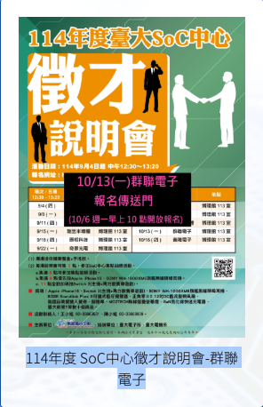

# NTU SoC Registration Bot

Log in to the NTU SoC event website and submit a registration when registration opens. Three methods are available: HTTP, early-login Selenium, and legacy Selenium.

**For your first run, follow steps 1–7 in order. For each later event, update `config.json`, run the checks, start registration, and review the results.**

Python implementations live in `src/`, and shell scripts live in `scripts/`. The root-level `init.sh` is the installation entry point. All methods share the root-level `.env` and `config.json`; there are no root-level Python wrappers.

## Understand the three methods

| Method | What it does | Browser required? | Submission behavior |
| --- | --- | --- | --- |
| **HTTP** | Logs in and prepares the activity data before opening, then sends the registration request directly at the scheduled time | No | At most one registration request per run |
| **Early-login Selenium** | Logs in with Chrome before opening, refreshes activity state at opening, then clicks the registration and meal controls | Yes | At most one registration request per run |
| **Legacy Selenium** | Uses the original browser workflow: starts Chrome and logs in only when registration opens | Yes | Starts the number of browser instances specified by `NumBots` |

HTTP and early-login Selenium share the **new runner**, `src/register.py`: they support early preparation, observation without submission, and structured results. Legacy Selenium uses `src/Bot.py` and keeps its original behavior. These method names are used throughout the guide, including the configuration table's **Applies to** column.

Use HTTP for direct submission, early-login Selenium for browser-based submission, or legacy Selenium when you need the original workflow. Running all three does not guarantee better results; they use the same account and may affect each other's sessions.

## Step 1: Check prerequisites and open the project

You need Linux with Bash and Miniconda or Anaconda. Both Selenium methods need Google Chrome. The launcher for all methods also needs tmux. Check your installation:

```bash
conda --version
tmux -V
google-chrome --version
```

Install any missing prerequisites before continuing. HTTP alone does not need Chrome, and individual methods can run without tmux if you keep their terminal open.

Open your local project directory. For example:

```bash
cd ~/mydisk/NTU_SoC_Bot
```

Replace this path if you saved the project elsewhere. Unless stated otherwise, run all commands below from the project root.

## Step 2: Create the Python environment and install dependencies

```bash
./init.sh
```

The installer:

1. Finds or creates the `SoC` conda environment. A new environment uses Python 3.13.7.
2. Installs the packages in `requirements.txt` into that environment.
3. Creates `.env` with the website URL and empty `EMAIL` and `PASSWORD` fields if the file does not exist. **Existing credentials are preserved.**

You can rerun the installer to reinstall the listed dependencies. It does not install Chrome or tmux, and it does not start registration.

`init.sh` calls `scripts/setup.sh`. Running `./init.sh` installs the environment; `source init.sh` also activates `SoC` in the current terminal after installation.

The launchers normally select the environment for you. To run Python commands directly, activate it first:

```bash
source scripts/env.sh
python src/register.py --help
```

Interpreter selection follows this order: the `PYTHON` environment variable, an activated `SoC` environment, `conda run -n SoC`, then `python` on PATH. For a custom virtual environment:

```bash
PYTHON=/path/to/venv/bin/python ./scripts/run_http.sh --now
```

## Step 3: Enter your credentials

Open the root-level `.env` in an editor and enter your website credentials:

```dotenv
URL="https://soc.ee.ntu.edu.tw/www/"
EMAIL="your-email"
PASSWORD="your-password"
```

If you already have a working `.env`, keep it. The file is ignored by Git. Do not include real credentials in public logs or issue reports.

## Step 4: Configure the event

Edit the root-level `config.json`. These are the three settings you normally change:

- `Time`: the **registration opening time**, not the event start time.
- `Event`: the complete event title, exactly as shown on the website.
- `Dietary`: `葷食` for non-vegetarian or `素食` for vegetarian. Keep these Chinese values because the website expects them.

This is a historical configuration that was used successfully. **Its opening time is in the past; replace the date and event before scheduling a new registration.**

```json
{
    "NumBots": 5,
    "Headless": true,
    "WaitTimeout": 420,
    "Time": "2026-10-05 10:00:00",
    "Event": "115年度 SoC中心徵才說明會-瑞鼎科技",
    "Dietary": "葷食",
    "Timezone": "Asia/Taipei",
    "PrepareSeconds": 180,
    "PollSeconds": 1,
    "ObserveSeconds": 30,
    "RequestTimeout": 15
}
```

For your first run, leave the other values unchanged unless you need different behavior. JSON does not allow a trailing comma after the final property.



| Setting | Purpose | Applies to |
| --- | --- | --- |
| `Time` | Registration opening time in `YYYY-MM-DD HH:MM:SS` format | All methods |
| `Event` | Complete event title; HTTP and early-login Selenium require an exact match | All methods |
| `Dietary` | `葷食` or `素食` | All methods |
| `Headless` | `true` hides Chrome; `false` shows it | Both Selenium methods |
| `NumBots` | Number of concurrent legacy browsers | **Legacy Selenium only** |
| `WaitTimeout` | Maximum element wait in seconds | **Legacy Selenium only** |
| `Timezone` | Time zone; default `Asia/Taipei` | HTTP and early-login Selenium |
| `PrepareSeconds` | Preparation lead time; 180 seconds = 3 minutes | HTTP and early-login Selenium |
| `PollSeconds` | Status polling interval; default 1 second, minimum 0.5 | HTTP and early-login Selenium |
| `ObserveSeconds` | Status polling window after opening; default 30 seconds | HTTP and early-login Selenium |
| `RequestTimeout` | Request or submission wait timeout; default 15 seconds | HTTP and early-login Selenium |
| `EventId` | Optional activity ID; the event title is still checked | HTTP and early-login Selenium |

Legacy Selenium uses the computer's local time zone. When running all methods, the system time zone must match the configured opening time. The new runner supplies defaults for its additional settings when loading an older configuration. `NumBots: 5` does not start five HTTP or early-login Selenium instances.

Configuration is read at startup. Restart a waiting process after changing it. For an alternative configuration, use `./scripts/run_http.sh --config /path/to/config.json`. The all-methods launcher always reads the root-level `config.json`.

## Quick start: Use after installation and configuration

Complete steps 1–4 before using these commands. Run them from the project root:

| Task | Command | Submits a registration? |
| --- | --- | --- |
| Install or reinstall dependencies | `./init.sh` | No |
| Check all methods | `./scripts/test_all.sh` | No; the legacy check is offline only |
| Check HTTP login and activity now | `./scripts/run_http.sh --now` | No |
| Check early-login Selenium now | `./scripts/run_selenium.sh --now` | No |
| Schedule all methods | `./scripts/run_all.sh` | **Yes** |
| Schedule HTTP only | `./scripts/run_http.sh` | **Yes** |
| Schedule early-login Selenium only | `./scripts/run_selenium.sh` | **Yes** |
| Start legacy Selenium | `./scripts/run_legacy.sh` | **Yes** |
| Read saved results | `./scripts/report.sh` | No |

`run_all.sh` starts real scheduled registration, not a test. Each invocation handles one configured event; it does not schedule recurring weekly runs.

## Step 5: Check the setup without registering

```bash
./scripts/test_all.sh
```

The script checks the methods sequentially:

1. **Legacy Selenium:** verifies imports, shared configuration, and initialization offline. It does not log in or open a browser.
2. **HTTP:** logs in with your real account and queries the activity. It does not submit a registration.
3. **Early-login Selenium:** opens Chrome, logs in, and queries the activity. It does not submit a registration.

The script continues after a failed check. Expect three `PASS` results in the summary; resolve any failures before scheduling registration.

- Successful login: `session_check` has `result: PASS`.
- Activity found: `activity` contains the expected ID, title, and opening time.
- Completed observation: usually `observed_only`. If already registered, the result may be `already_registered_before_run`.
- A legacy `PASS` **does not validate its live browser or submission flow**.

Check logs are saved under `runs/check_all_<time>_<id>/`, including per-method output and `results.txt`. HTTP and early-login Selenium also save their normal structured run records. Immediate observation with `--now` works even if the configured opening time is in the past.

## Step 6: Start scheduled registration

After checking the configuration and test results, run this command once:

```bash
./scripts/run_all.sh
```

It creates a tmux session named `soc-all` with three windows:

| Window | Behavior |
| --- | --- |
| `http` | Logs in and prepares data early, then submits at opening |
| `selenium` | Logs in early, refreshes activity state at opening, then uses the page controls |
| `legacy` | Starts Chrome, login, and page interaction at opening; uses `NumBots` |

With `NumBots: 5`, legacy Selenium starts five browsers in addition to the two new methods. Each new method submits at most one registration request per invocation. A timeout triggers result checks, not an automatic resubmission. Login and status queries are separate requests.

The methods share an account but operate independently without a coordination lock. They may both submit, and account sessions may interact. After one succeeds, another may only receive an already-registered response; this is not an independent comparison of their ability to obtain a place. To use only one method, run `./scripts/run_http.sh` or `./scripts/run_selenium.sh` in your own tmux window.

`run_all.sh` rejects past opening times and an existing `soc-all` session. It does not detect runners you started separately. Do not launch duplicate processes.

### View progress and detach

```bash
tmux attach -t soc-all
```

- List windows: press `Ctrl+b`, release, then press `w` and select a method.
- Leave the session running: press `Ctrl+b`, release, then press `d` to detach.
- From another tmux session: use `tmux switch-client -t soc-all`.
- Closing your terminal does not stop the detached session. **Keep the computer awake and online.**

For a 10:00 opening with a three-minute preparation lead time, start the launcher before 09:57:

```text
09:57:00  Start login and prepare activity data
09:59:50  Check session validity
10:00:00  Submit HTTP request / refresh activity for Selenium
```

While waiting in a terminal or tmux, the new runner updates its countdown **on the same line every second**. It still saves a heartbeat to the run records every 60 seconds without printing a separate JSON heartbeat:

```text
[09:50:00] Waiting to log in | Remaining: 0d 00:07:00 | Next: 2026-10-05 09:57:00 CST
```

The status text is shortened to fit narrow terminals without wrapping. When output is redirected to a file or pipe, it prints a normal line every 60 seconds instead of terminal control characters. Login, submission, and error events still appear on separate lines. Restart a waiting process to apply this display change.

Event titles retain their original Chinese text. Meal choices appear as `non-vegetarian` or `vegetarian` in the terminal, while submitted values remain Chinese. Heartbeats and countdown updates are suppressed in the final second before the next action. If preparation misses the opening time, the new runner stops rather than silently submitting late.

### Automatic closure and manual cancellation

Each tmux window closes when its method exits. The `soc-all` session closes after its final window exits; **no separate cleanup script is needed**. Closure depends on process completion, whether registration succeeds or fails. A stuck process is not forcibly stopped.

Unsaved terminal output disappears when its window closes. This matters especially for legacy Selenium, which does not produce the new runner's structured report. Saved records under `runs/` remain intact.

To cancel all methods before they finish:

```bash
tmux kill-session -t soc-all
```

This immediately stops the processes. It does not undo a registration already accepted by the website. Check your registration status before deciding to restart.

## Step 7: Check which method registered successfully

```bash
./scripts/report.sh
```

Read the outcome and server response together:

| Result | Meaning |
| --- | --- |
| `registered_confirmed` + `INSERT` | This request added a registration, confirmed by a subsequent query |
| `registered_confirmed` + `RJ` | The account was already registered; this request did not add it |
| `observed_only` | Observation completed without submitting |
| `rejected` + `OUT` | Outside the registration period |
| `rejected` + `OVER` | Capacity reached |
| `unknown` | Outcome uncertain; check the website before sending another request |
| `error` | Inspect the error type in the corresponding `events.jsonl` |

Legacy Selenium does not produce this report. Its success message is based on UI actions, not confirmed server acceptance. When multiple methods run together, `ujoin: 1` alone cannot identify which one added the registration; look for the `INSERT` response.

## Routine for each new event

```bash
cd ~/mydisk/NTU_SoC_Bot
# Edit Time, Event, and Dietary in config.json first.
./scripts/test_all.sh
# After the checks pass, and before registration opens:
./scripts/run_all.sh
# After registration finishes:
./scripts/report.sh
```

## Project layout and command migration

```text
NTU_SoC_Bot/
├── README.md               Consolidated documentation
├── config.json             Shared configuration
├── .env                    Local credentials; ignored by Git
├── requirements.txt        Python dependencies
├── init.sh                 Installer; executable or sourceable
├── src/
│   ├── __init__.py          Python package
│   ├── register.py         HTTP, early-login Selenium, and reports
│   └── Bot.py              Legacy Selenium implementation
├── scripts/
│   ├── setup.sh            Environment setup; preserves existing .env
│   ├── env.sh              Activate with: source scripts/env.sh
│   ├── run_all.sh          Schedule all methods with automatic tmux closure
│   ├── run_http.sh         HTTP launcher
│   ├── run_selenium.sh     Early-login Selenium launcher
│   ├── run_legacy.sh       Legacy Selenium launcher
│   ├── test_all.sh         Checks without registration
│   ├── report.sh           Saved results
│   └── run.sh              Shared launcher; normally called internally
├── images/                 Documentation images
└── runs/                   Historical records; ignored by Git
```

Old commands such as `./run_all.sh` and `./test_all.sh` are now `./scripts/run_all.sh` and `./scripts/test_all.sh`. Replace `source env.sh` with `source scripts/env.sh`. The root-level `init.sh` remains the installer entry point and calls `scripts/setup.sh` without overwriting an existing `.env`.

Python implementations are in `src/`; use the shell launchers or `python src/register.py ...`. There are no root-level Python entry points. Replace old Python commands with `python src/Bot.py` or `python src/register.py ...`, and use `from src import Bot, register` for imports. Shell launchers change to the project directory automatically; Python implementations locate configuration and credentials relative to the project root.

## Advanced commands

After activating the environment, you can invoke Python directly:

```bash
source scripts/env.sh
python src/register.py http --submit             # Schedule real registration
python src/register.py early-selenium --submit   # Schedule real registration
python src/register.py http --now                # Observe immediately; no submission
python src/register.py early-selenium --now      # Observe immediately; no submission
python src/register.py http                      # Observe at the opening time
python src/register.py early-selenium            # Observe at the opening time
python src/register.py report                    # Read local results only
python src/register.py --help
```

The HTTP and early-login Selenium shell launchers default to `--submit`. Direct Python invocation without an action flag defaults to observation.

To send one **real registration request immediately**:

```bash
./scripts/run_http.sh --submit-once
```

This ignores the scheduled time and submits at most once after login. It can create a real registration; it is not a simulation. `--submit`, `--now`, and `--submit-once` are mutually exclusive. Immediate submission is HTTP-only. Already-registered activities are skipped, and neither a timeout nor an `OUT` response causes an automatic resubmission.

The following sections describe record fields, website interfaces, and historical verification for troubleshooting.

## Records and interpreting results

```bash
./scripts/report.sh
# Equivalent:
python src/register.py report

# Check whether runners still exist.
pgrep -af '[p]ython.*register.py'
```

Each run creates `runs/<start-time>_<mode>/`:

- `summary.json`: configuration, execution mode, latest activity state, response code, outcome, submission offset, and response duration.
- `events.jsonl`: timestamps, heartbeat, session checks, request start/end, HTTP status, server Date header, response codes, verification, and sanitized errors.

The directory name uses the process start time, which may precede registration by several days. Existing historical records remain readable. Files are updated during execution, so an interrupted run still has its last recorded state. A saved `waiting` status is not proof that the process is still alive; check its PID or the timestamp of the last heartbeat.

| Status | Meaning |
| --- | --- |
| `registered_confirmed` | A subsequent query found the account registered; attribution requires the response code |
| `accepted_unverified` | Received `INSERT` or `RJ`, but readback did not confirm registration |
| `rejected` | Received a known rejection (`OVER`, `NAVA`, or `OUT`) |
| `unknown` | Submission outcome could not be determined |
| `observed_only` | Read-only observation completed |
| `already_registered_before_run` / `already_registered_before_submit` | Registration was already present; no new submission was made |
| `not_open_or_full` | Selenium could not proceed with an open registration state |
| `submission_pending` | Submission was about to happen; if interrupted, query status before trying again |
| `starting` / `waiting` / `preparing` / `waiting_for_target` / `observing` / `ready_to_submit` | Intermediate execution states |
| `error` / `interrupted` | Execution failed or was interrupted; inspect the last events |

| Server response | Meaning |
| --- | --- |
| `INSERT` | This request added a registration |
| `RJ` | The account was already registered |
| `OVER` | Capacity reached |
| `NAVA` | Requested attendance method unavailable |
| `OUT` | Outside the registration period |
| `UNKNOWN` | Unrecognized or unavailable response; not proof of rejection |

The runner performs at most three readback checks after a submission, including after an uncertain timeout. It does not retry the registration POST. If several methods run together, a readback with `ujoin: 1` alone cannot identify the winner; use `INSERT` versus `RJ`. A timeout followed by successful readback remains ambiguous about attribution.

`submit_offset_ms` measures the local submission start relative to the target, not arrival at the server. HTTP measures just before the client call; Selenium measures jQuery `ajaxSend`. Selenium's `response_ms` can include dismissing the native alert, so it is not directly equivalent to HTTP network latency. For `immediate_submit`, the target is invocation time, not the event opening time. Server Date headers are recorded for diagnosis, not automatic clock synchronization.

The new runner does not save credentials, cookies, raw responses, profiles, or full pages. Legacy Selenium (`src/Bot.py`) can still save HTML and screenshots; those files and `runs/` are ignored by Git. Sessions are not reused across executions.

## Verified behavior

On 2026-10-01, HTTP and Chrome login/status checks succeeded for event 499, `115年度 SoC中心徵才說明會-瑞鼎科技`. An immediate HTTP submission before opening returned `OUT`. Initial Chrome login timeouts were resolved by waiting for the modal's `shown.bs.modal` event.

On 2026-10-05 at 10:00 Asia/Taipei:

| Method | Local submission offset | Response | Outcome |
| --- | --- | --- | --- |
| HTTP | +0.47 ms | `INSERT` after 139.95 ms | Registration confirmed by +191.98 ms |
| Early-login Selenium | +646 ms | `RJ` | Account already registered |

The HTTP request added this registration. The Selenium result validates its request path, but does not establish whether it would have obtained a place on its own.

Historical evidence remains in:

- `runs/20261001_221627_777029_http/` and `runs/20261001_222245_681808_early-selenium/`: successful initial observation checks.
- `runs/20261001_224126_765288_http/`: immediate submission rejected with `OUT`.
- `runs/20261001_224929_285086_http/`: successful scheduled HTTP registration.
- `runs/20261001_224957_509084_early-selenium/`: scheduled Selenium `RJ` response.

Earlier failed development runs are retained; their `error` status does not mean registration failed on opening day. This cleanup was checked with 20 offline regression tests before removing the requested test files; it did not submit another real registration.

## Website adapter details

The adapter follows the [official website's public JavaScript](https://soc.ee.ntu.edu.tw/www/js/ntusoc_1_1.js), inspected on 2026-10-01:

| Endpoint | Parameters / response |
| --- | --- |
| `POST fn/login.php` | `login_email`, `login_pw`; successful login returns `PASS` |
| `POST fn/checksession.php` | Valid session returns `PASS` |
| `GET fn/getdata.php` | `scope=home` returns `jobs` and `socs`; pagination uses `scope=more`, `kind=job` or `soc`, `offset`, `limit` |
| `GET fn/getdata.php` | `scope=item&type=activity&id=...` returns `item`, including availability, `ujoin`, `s_sdate`, and `special` |
| `POST fn/actjoin.php` | Form fields `aid`, `t=non`, and `special` when a meal selection is required |

For example, `special=#葷食*素食` supplies two meal options. The configured choice is checked against those options and sent as a UTF-8 encoded form value. Unsupported meal formats stop execution. Activity 137 requires an additional profile-confirmation flow and is explicitly unsupported by the new runner. Only the NTU SoC HTTPS host is supported. The inspected frontend did not show an extra CSRF token for these requests; website changes may require adapting this implementation.

## Compatibility

- `python src/Bot.py` and the original `Bot`, `job`, and `multi_thread_run` APIs in `src.Bot` remain available. The legacy browser flow and dependencies are retained.
- The new runner is `src/register.py`; there are no root-level Python wrappers. Update saved commands that reference removed experimental filenames. The `early-selenium` mode name is unchanged.
- Configuration is consolidated in `config.json`, and documentation in this README. Historical `runs/` records are not rewritten.
- Existing processes do not reload changed code or configuration. Restart them if you need new settings to take effect.

## Troubleshooting

| Symptom | What to check |
| --- | --- |
| `Permission denied` | Run `chmod +x init.sh scripts/*.sh`, then retry |
| `ModuleNotFoundError` | Run `./init.sh` and confirm the intended environment; `missing_module` identifies the missing package |
| `conda: command not found` | Install or initialize conda, then open a new terminal |
| Chrome or driver startup failure | Check `google-chrome --version`, driver compatibility, and network access for driver downloads; set `Headless: false` to inspect the browser |
| Invalid session or login failure | Check `.env` locally and inspect response codes; do not publish credentials |
| `Opening time is in the past` | Update `config.json` for the next event; use `--now` if you only want an immediate observation check |
| `Session soc-all already exists` | Inspect it with `tmux attach -t soc-all` before starting another run |
| No new waiting output | Check the last heartbeat and run `pgrep -af '[p]ython.*register.py'`; old records do not prove a process is still running |
| The tmux session disappeared | All methods may have exited; run `./scripts/report.sh`. Closure alone does not mean registration succeeded |
| Activity not found | Check the complete title; optionally set `EventId`, which is still checked against the title |

The legacy `Bot(headless=False)` interface remains available for browser debugging. When reporting a problem, include the relevant sanitized error and run outcome, without credentials or personal data.

Use the tool only for registrations you are authorized to make, follow the website's rules, and avoid excessive requests.
